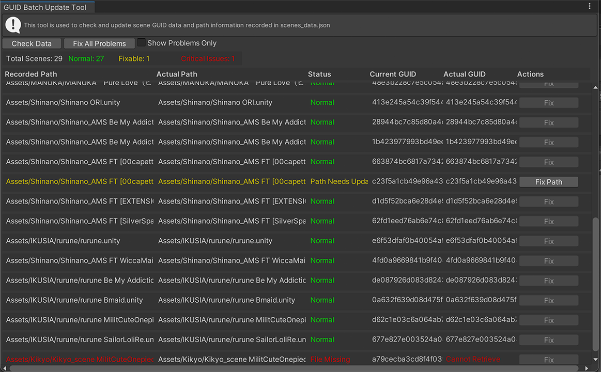
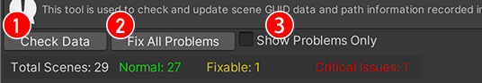
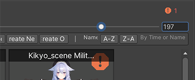

# GUID 一括更新ツール  GUID管理

## 使用シーン

ブラウザーに記録されたシーンのパスや GUID が、プロジェクト内のファイルと一致しないときに確認・修正するツールです。

- シーンを移動・改名した後に、記録されたパスの更新が必要か確認する。
- 古いデータの読み込みやプロジェクトの移行後に、GUID の不足や不一致を確認する。
- メインウィンドウでシーンファイルの欠落が表示されたときに、元のファイルが見つかるか確認する。

-----

## ツールを開く

- メインウィンドウ上部の **GUIDツール** をクリックします。
- または `Tools → CYN-lab → VRCAvatarSceneBrowser → GUID Batch Update Tool` を選びます。

## インターフェースと機能

### ボタンと色

- ① **データをチェック**：シーンの記録を読み直し、パス・GUID・ファイルが対応しているか確認します。
- ② **すべての問題を修正**：確認後、ファイルを見つけられる記録をまとめて修正します。
- ③ **問題項目のみ表示**：正常な記録を非表示にし、確認が必要な項目だけを表示します。

対象の行にある **修正** をクリックして、1件ずつ処理することもできます。

| 状態 | 色 | 意味 | 対処 |
|------|------|------|------|
| 正常 | 緑 | パスと GUID が対応し、ファイルも存在する | 操作は不要です |
| パス更新が必要／パスが一致しません | 黄 | GUID が示すファイルの場所と記録が異なる | 実際のパスを確認して修正します |
| GUIDなし／GUID更新が必要 | 黄 | ファイルは存在するが、記録の GUID がない、または一致しない | GUID を修正します |
| ファイル欠損 | 赤 | 記録のパスと GUID のどちらからもシーンが見つからない | 元のファイルやバックアップを確認します |

> シーンファイルが見つからない場合は、メインウィンドウのサムネイルにもエラーアイコンが表示されます。
>
> 

#### データ列の説明

| 列 | 内容 |
|------|------|
| 記録パス | ブラウザーに保存されているシーンのパス |
| 実際のパス | GUID から見つかったパス |
| 状態 | 現在の確認結果 |
| 現在の GUID | ブラウザーに記録されている GUID |
| 実際の GUID | 現在のシーンファイルの GUID |
| 操作 | 修正可能な項目に対して修正を実行 |

## 注意事項

- 修正すると、プラグイン内の `Data/scenes_data.json` が変更されます。必要に応じて、先にこのファイルをバックアップしてください。
- 黄色は記録に不一致があることを示します。シーンを開ける場合もあるので、まず実際のパスを確認してください。
- 元のパスと GUID のどちらからもファイルが見つからない場合、削除されたシーンを自動で復元することはできません。
- このツールが扱うのはシーンの記録のみです。Avatar 設定内の見つからないオブジェクトや、スクリーンショット画像は復元しません。
