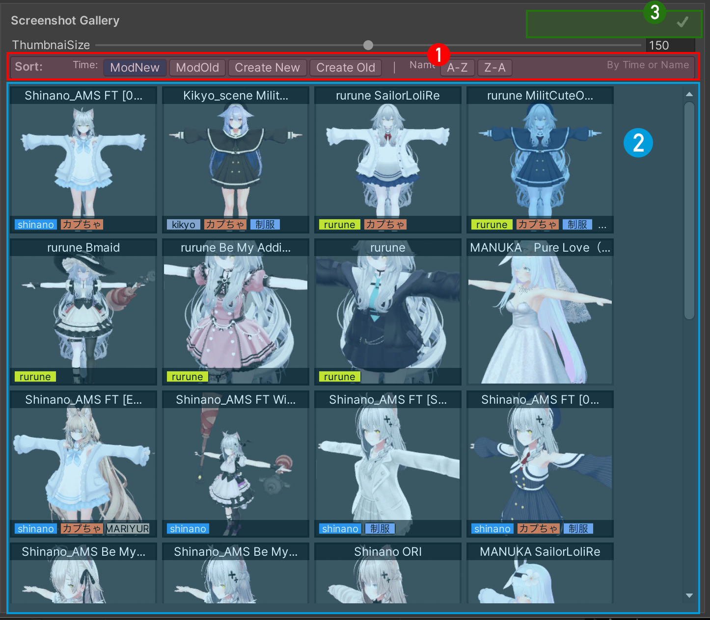
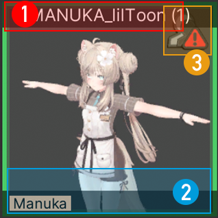
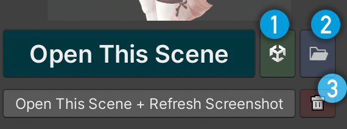

# 主窗口

## 标题栏

顶部可以切换中文、日文和英文，并提供以下操作：

- **刷新当前打开的Scene截图**：拍摄当前 Scene 视图；场景中有至少两个 Avatar 时保存当前 Avatar 配置。
- **刷新所有截图（需要等待）**：逐个打开库中的场景并拍摄普通场景截图，有进度提示，可中途取消。
- **GUID工具**：检查和修复场景路径与 GUID 的关联。
- **截图设置**：选择 PNG/JPEG 和 JPEG 质量。

!!! info "更新 Avatar 配置截图"
    “刷新所有截图”不会逐个加载并更新 Avatar 配置。更新配置时，请先加载目标配置，再使用工具栏截图按钮或“刷新当前打开的Scene截图”。批量刷新可能让已有配置出现过时警告。

---

## 中间区域（截图画廊）

画廊显示已记录的场景截图和 Avatar 配置截图。同一场景的多个配置会分别显示。

**选中缩略图后，边框颜色表示其类型；未选中时不显示彩色边框：**

- **蓝色边框**：普通场景截图，通常用于没有 Avatar 或只有一个 Avatar 的场景。
- **绿色边框**：Avatar 配置截图，记录多 Avatar 场景中的一组激活状态。

① 截图排序与大小

拖动滑块可以调整缩略图大小。排序支持名称顺序，以及创建时间、修改时间的新旧顺序。

!!! info "排序说明"
    时间排序使用插件保存的记录，不是 Unity Scene 文件在磁盘上的更新时间。配置重新截图后会更新修改时间，并保留原来的创建时间。

② 截图显示区域

单击缩略图查看详情。双击普通截图打开场景；双击 Avatar 配置截图则打开场景并加载配置。

左侧搜索框按场景路径匹配，可以输入 Scene 名称或文件夹名；不按 Avatar 配置名称搜索。也可以选择标签筛选。选中多个标签时，需要同时匹配这些标签；场景标签匹配时会显示该场景的配置，配置自身的标签也可用于筛选。点击筛选区域的 **清除** 取消标签筛选。

③ “场景库”右侧的状态统计

- 单个人形错误图标旁的数字：找不到场景文件的记录数。
- 多个人形错误图标旁的数字：当前画廊中带过时或 Avatar 缺失警告的配置数。其中，Avatar 对象是否缺失只会对当前活动场景检查。
- 没有检测到以上问题时，显示绿色状态图标。

---

### 单个缩略图

① 顶部显示 Scene 名称；Avatar 配置显示 Avatar 名称，组合配置以 `+` 连接名称。

② 下方显示当前场景或配置自己的标签。

③ 错误图标表示场景文件缺失、配置过时，或配置引用的 Avatar 无法找到。场景路径问题可用 [GUID 工具](guid-batch-update-tool.md) 检查；Avatar 对象问题需要打开场景查看。

---

## 右键菜单

右键普通场景缩略图，可以：

- 打开场景。
- 刷新截图。
- 在 Unity 项目窗口或系统文件浏览器中定位场景文件。
- 清除该场景的所有标签。
- 删除截图数据。

右键 Avatar 配置缩略图时，打开操作分为 **打开场景并加载配置** 和 **仅打开场景**。清除标签和删除操作针对当前配置。

!!! info "右键刷新截图"
    当前右键菜单的“刷新截图”会拍摄普通场景截图，不会先恢复所选 Avatar 配置。要更新配置图片，请按本页顶部说明操作。

---

## 右侧详细信息

选中缩略图后，右侧显示预览、场景信息以及标签编辑区域。**打开此场景** 只打开场景，不加载 Avatar 配置。

选中普通截图时编辑 **场景标签**；选中 Avatar 配置时编辑 **配置标签**。已有标签旁的 **×** 只把标签从当前项移除，不会删除标签本身。

### 小按钮

① 在 Unity 项目窗口里定位 Scene 文件。

② 在系统文件浏览器中定位 Scene 文件。

③ 删除选中项的截图数据，需要确认，不会删除 `.unity` 场景文件。

**打开此场景+刷新截图** 与右键“刷新截图”一样，更新的是普通场景截图。

!!! warning "删除范围"
    删除普通截图会移除该场景在浏览器中的记录。删除 Avatar 配置会移除该配置及其图片；如果这是该场景最后一个配置，场景记录也会被移除，即使之前还保存过普通截图。删除操作没有撤销入口。

---

## Avatar 配置面板（多 Avatar 功能）

选中场景或配置后，右侧下方的 **Avatar 配置** 区域会列出该场景已保存的配置；没有配置时显示提示。

- 每行是一组已保存的 Avatar 激活状态。
- ★ 绿色：只有一个 Avatar 激活。
- ◆ 橙色：多个 Avatar 同时激活的组合。
- 没有 Avatar 激活的配置显示为灰色。
- **▶**：打开场景并恢复该配置中记录的 Avatar 激活状态。
- **✕**：确认后删除该配置。

!!! tip "创建或更新配置"
    场景中有至少两个 VRChat Avatar 时，调整 Avatar 根对象的激活状态，然后点击工具栏截图按钮。新的组合会新增配置，已有组合会更新原截图。加载配置不会恢复服装、材质或拍摄视角。
