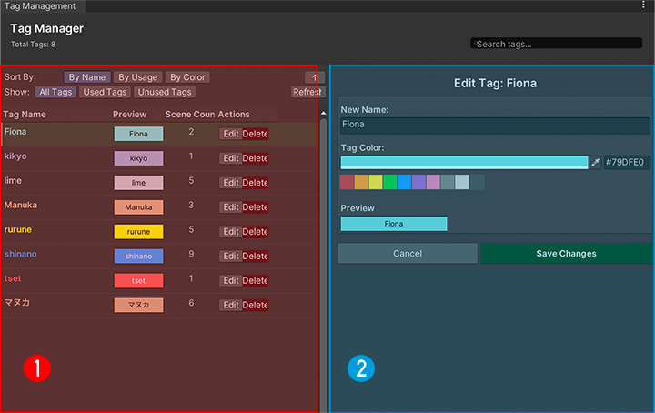

# Tag Manager

## Opening Tag Manager

You can open it from either location:

1. **Main window**: click **Manage Tags** in the tag filter area on the left.
2. **Details panel**: select a scene or avatar configuration, then click **Manage Tags** in the tag section on the right.

## Layout

The window has two panels:

- **① Tag list**: search by name at the top. Sort by name, usage, or color, and use the arrow to switch between ascending and descending order. You can also show only used or unused tags.
- **② Editor**: click **Edit** on a tag's row, change its name and color here, then save. Names cannot be empty or duplicate another tag's name.

Create tags in the main window's right panel: enter a name, choose a color, and click **Create New Tag**. The new tag is automatically added to the selected scene or avatar configuration.

!!! info "What the usage count includes"
    The current count includes scene tags only, not tags on individual avatar configurations. A tag shown as unused may still be used by a configuration.

### Deleting tags

Click **Delete** on a tag's row and confirm to remove it from the tag list and from scenes that use it. This action cannot be undone.

To remove a tag from just one scene or configuration, click the **×** beside it in the main window's right panel. You do not need to delete the tag itself.

## Notes

1. **Scene and configuration tags** are saved separately. Adding a tag to one avatar configuration does not add it to the others.
2. **Renaming a tag** updates scene tags, but does not update the old name stored in avatar configurations. For affected configurations, remove the old name and add the renamed tag.
3. **Deleting a tag** does not currently remove the matching tag from avatar configurations. You can remove any remaining entries in the configuration's details panel.
4. **Saving**: adding or removing tags is saved automatically. After editing a name or color in Tag Manager, click **Save Changes**.
