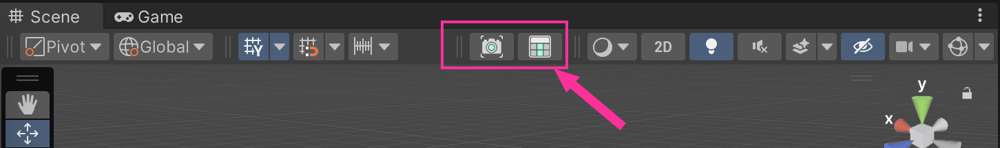
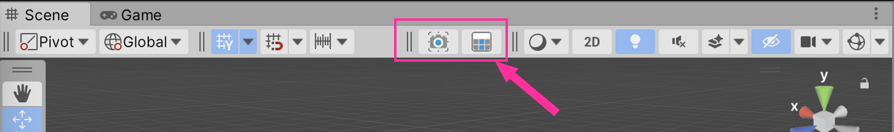
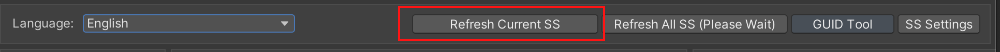

# クイックスタート

---

## ステップ1：スクリーンショットを撮る

記録したいシーンを開き、`.unity` ファイルとして保存します。Scene ビューで撮りたいものが画面に収まるように調整してください。撮影には Scene ビューのカメラを使います。

プラグインをインポートしたら、Scene ウィンドウのツールバーにある撮影ボタンとブラウザーを開くボタンを確認します。




撮影ボタンをクリックすると、現在のシーンのサムネイルが保存されます。

{ width="80" }

メニューからメインウィンドウを開いて撮影することもできます。

`Tools → CYN-lab → VRCAvatarSceneBrowser → Main Window`

ウィンドウ上部の **現在のシーンのSSを更新** をクリックします。



---

## ステップ2：スクリーンショットライブラリを確認

ツールバーのブラウザーボタン、または上記のメニューからメインウィンドウを開きます。保存した画像は中央のギャラリーに表示されます。初めて使うときは、まず1枚撮影してください。

サムネイルの大きさを変えたり、名前・作成日時・更新日時で並べ替えたりできます。左側の検索欄やタグでもシーンを絞り込めます。

[→ メインウィンドウの詳細](main-window.md)

---

## ステップ3：シーンを開く

通常のシーンスクリーンショットからシーンを開く方法は3つあります。

1. **サムネイルをダブルクリック**する。
2. **サムネイルを右クリック → シーンを開く**を選ぶ。
3. **サムネイルを選択 → 右側の「シーンを開く」**をクリックする。

Avatar 設定のサムネイルをダブルクリックすると、シーンを開くと同時に、保存したアバターの表示状態を読み込みます。シーンを開くだけにしたい場合は、右クリックメニューの **シーンのみを開く**、または右側の **シーンを開く** ボタンを使ってください。

シーンを切り替える際、現在のシーンに未保存の変更があれば、Unity が保存するかどうかを確認します。

---

## ステップ4：タグを追加する

サムネイルを選び、右側のタグ欄で既存のタグを選択して **追加** をクリックします。新しい名前と色を指定して **新しいタグを作成** をクリックすると、作成したタグが選択中の項目に追加されます。

通常のスクリーンショットにはシーンタグ、Avatar 設定のスクリーンショットには設定ごとのタグを付けられます。ある設定にタグを付けても、同じシーンのほかの設定には追加されません。

タグの編集や管理については、[タグマネージャー](tag-manager.md)をご覧ください。

---

## 複数Avatarシーンの使い方

現在のバージョンでは、非アクティブなものも含めてシーン内の VRChat アバターを数えます。**2体以上**ある場合は Avatar 設定として保存し、1体以下の場合は通常のシーンスクリーンショットとして保存します。

シーン内のアバターごとに画像を保存する手順は次のとおりです。

1. Hierarchy でアバターのルートオブジェクトを選び、撮りたいアバターをアクティブに、ほかを非アクティブにします。切り替えるのは Inspector 上部のチェックボックスです。Hierarchy の目のアイコンではありません。アバターに親オブジェクトがある場合は、親もアクティブにしてください。設定を読み込んでも親は自動でアクティブになりません。
2. Scene ビューを調整し、ツールバーの撮影ボタンをクリックします。
3. ほかのアバターでも繰り返すと、それぞれの設定の画像がギャラリーに並びます。

複数のアバターを同時にアクティブにして、確認ダイアログから組み合わせとして保存することもできます。すべて非アクティブにした場合は、確認後に「Avatarなし」の設定として保存されます。

**同じ組み合わせを撮り直す場合**

アクティブなアバターの組み合わせが同じなら、既存の設定の画像を更新します。設定は重複して作成されません。更新したい設定を読み込んでから、ツールバーの撮影ボタン、またはメインウィンドウ上部の「現在のシーンのSSを更新」を使ってください。

表示状態を読み込む方法は3つあります。

- 設定のサムネイルをダブルクリックする。
- 設定のサムネイルを右クリックし、**シーンを開いて設定を読込** を選ぶ。
- サムネイルを選び、右側の **Avatar 設定** 欄で該当する行の **▶** をクリックする。

設定に保存されるのは、アバターのルートオブジェクトのアクティブ状態です。衣装・マテリアル・ポーズ・Scene ビューの視点は復元されません。読み込んだ状態をシーンに残したい場合は、Unity のシーンを保存してください。

**必要な環境**

Avatar 設定機能には VRChat SDK（VRCSDK3）が必要です。SDK がなくても撮影はできますが、Avatar 設定は保存されません。

---

## Unityメニュー

```text
Tools
└── CYN-lab
    └── VRCAvatarSceneBrowser
        ├── Main Window              # メインウィンドウ
        ├── GUID Batch Update Tool   # GUID 一括更新ツール
        └── Screenshot Settings...   # 画像形式・画質の設定
```

### Main Window（メインウィンドウ）

画像の閲覧、シーンを開く操作、タグによる絞り込み、Avatar 設定の管理を行います。

### GUID Batch Update Tool（GUID一括更新ツール）

記録されているシーンのパスと GUID を確認し、元のファイルが見つかる場合に関連付けを修正します。[→ 詳細](guid-batch-update-tool.md)

### Screenshot Settings...（スクリーンショット設定）

PNG または JPEG を選べます。JPEG の品質は 1～100 で、初期値は 80 です。PNG ではこの品質設定を使いません。**Save** で保存し、**Close** では保存せずに閉じます。設定は以降の撮影に適用され、既存の画像は一括変換されません。
